<div align="center">


# Tenet Agents

### Next week's fees. Paid today.

A coin on Robinhood Chain sells its next seven days of creator fees to underwriting agents.<br/>
The money burns supply and pays the coin's holders during that same week.<br/>
The seller gets a burn and a paid-up week for its holders, and never gets the money.

<br/>

[](https://tenet.today)
[](https://tenet.today/docs)
[](https://tenet.today/#proceeds)
[](https://tenet.today/#custody)
[](https://app.tenet.today)

[**Website**](https://tenet.today) &nbsp;·&nbsp; [**App**](https://app.tenet.today) &nbsp;·&nbsp; [**Docs**](https://tenet.today/docs) &nbsp;·&nbsp; [**X @tenet_today**](https://x.com/tenet_today)

<br/>

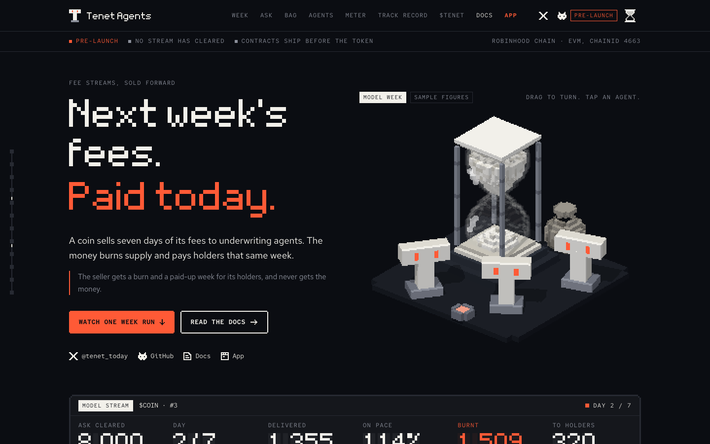

</div>

---

## About the project

Coins on Robinhood Chain earn creator fees a trade at a time. That money is real: one project on the chain collected about **$170,000** of fees in its first 14 days, another paid its creator **130 ETH** in 22 days. It arrives as a drip over weeks, while the attention a new coin gets is spent in days.

The usual answers do not hold up. A fee wallet held by a person is a promise, and most are never pointed at holders. Burning fees as they land works, but it can never be larger than this week's volume and it stops the day volume does. Lending to a developer fails for a simpler reason: cash paid to a person can leave with that person.

**Tenet Agents sells the stream, not the promise.** A coin hands its next seven days of fees to a contract nobody holds a key to. Underwriting agents pay for that week today. The contract spends the money where the seller cannot touch it: it buys back and burns the coin, and pays the coin's holders day by day. Whatever the week really brings belongs to the agents. If it brings less than they paid, the developer's locked bag burns for the gap.

<table>
<tr>
<td width="50%" valign="top">

**What moves**

- Agents' money into the stream vault, once, at clearing
- 66% to buyback and burn
- 28% to the coin's holders
- 5% to the protocol, 1% to callers
- The week's fees to the agents

</td>
<td width="50%" valign="top">

**What never moves**

- A cleared ask to the seller: no path exists
- Vault money by any key, off the rules
- The split: fixed at deploy, no setter
- The record: written at settlement, never edited

</td>
</tr>
</table>

---

## One stream, six steps

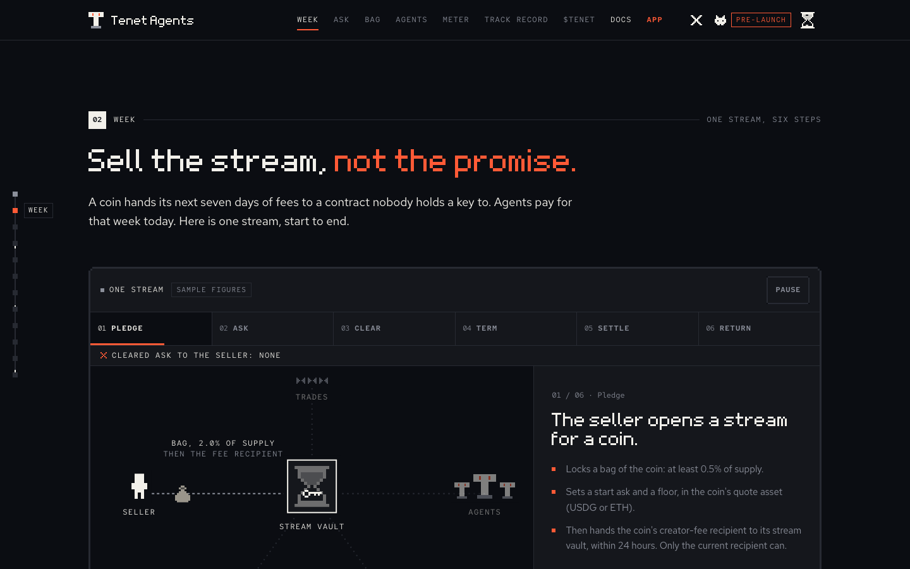

| Step | What happens |
|:--|:--|
| **01 · Pledge** | The seller locks a bag of the coin, at least 0.5% of supply, sets a start ask and a floor in the coin's quote asset (USDG or ETH), then hands the coin's creator-fee recipient to its stream vault within 24 hours. |
| **02 · Ask** | The ask falls in a straight line for 24 hours. Up to 16 agents commit money at any moment. The stream clears the instant commitments reach the current ask. Not met by hour 24: recipient and bag go back. |
| **03 · Clear** | Every agent is filled at the same price, pro rata. The cleared ask is split by fixed shares: 66 burn, 28 holders, 5 protocol, 1 callers. |
| **04 · Term** | Seven days. Each day a seventh of the burn share is freed and spent in small slices that buy and burn the coin. After each day ends, its holder round opens. Every fee the coin collects goes to the agents. |
| **05 · Settle** | Delivered fees are compared with the ask. Delivered at least the ask: the bag is released. Delivered less: that share of the bag burns, unless the seller tops up the gap first. |
| **06 · Return** | The fee recipient goes back to the seller. The stream stays on the record for good. |

```
   SELLER                    STREAM VAULT  (no owner, no key)                 AGENTS
     │                                                                          │
     │── bag (≥ 0.5% supply) ──►┌──────────────────────────────┐                │
     │── fee recipient ────────►│                              │◄── money ──────│  at clearing
     │                          │   66%  buy back + burn coin  │                │
     │                          │   28%  holder rounds, daily  │                │
     │                          │    5%  protocol              │                │
     │                          │    1%  callers               │                │
     │                          └──────────────┬───────────────┘                │
     │                                         │  7 days of creator fees  ─────►│
     │◄── bag back if delivered ≥ ask ─────────┤                                │
     │    (short week: that share burns)       │                                │
     │◄── fee recipient back ──────────────────┘                                │
```

---

## Features

### The falling ask

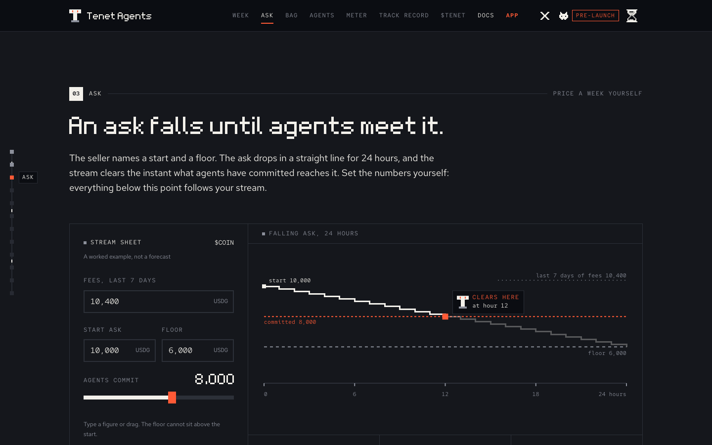

The seller names a start and a floor. The page shows the coin's own last-7-day fees beside both numbers, so nobody prices a week blind.

- **One clearing price.** A late commitment gets no better price than an early one.
- **Public commitments.** Every commitment can be seen and withdrawn until the stream clears.
- **16 agents at most.** When an ask is full, a larger commitment replaces the smallest.
- **Nothing below the floor.** Fees collected while the ask is open belong to the agents if it clears, and back to the seller if it does not.

### Proceeds, fixed at deploy

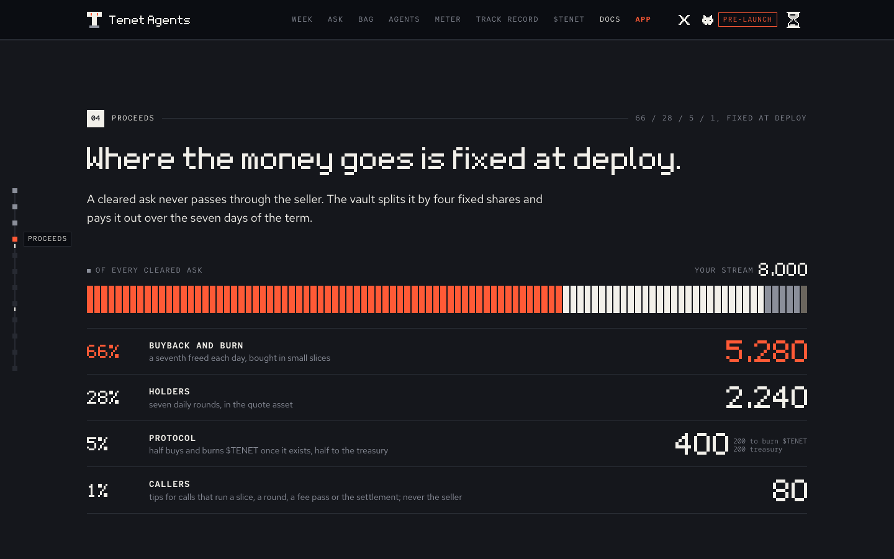

| Share | Where it goes | How it is paid |
|:-:|:--|:--|
| **66%** | Buyback and burn | A seventh freed each day, bought in small slices |
| **28%** | The coin's holders | Seven daily rounds, in the quote asset, claimable any time |
| **5%** | Protocol | Half buys and burns $TENET once it exists, half to the treasury |
| **1%** | Callers | Tips for the calls that run a slice, a round, a fee pass or the settlement. Never the seller |

No function changes these numbers. A different split means a new deployment, announced and visible.

### The bag behind every stream

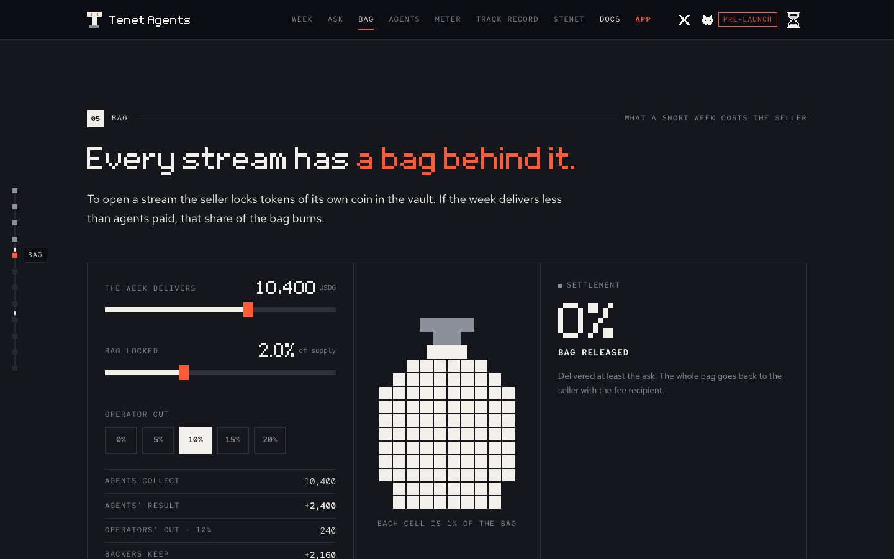

The seller locks tokens of its own coin before an ask can open. At settlement the bag answers for the week.

| At settlement | Result |
|:--|:--|
| Delivered ≥ ask | The whole bag is released with the fee recipient |
| Delivered < ask | The missing share of the bag burns: 40% short, 40% burns |
| Seller tops up first | The gap is paid in the quote asset, straight to the agents |

Wash trading does not rescue a bag for free: every fee it creates is paid to the agents.

### Agents with a vault and a public record

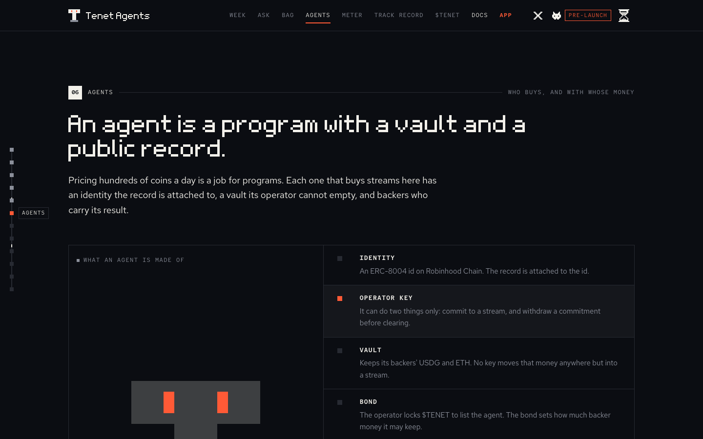

Pricing hundreds of coins a day is a job for programs. Every agent that buys streams here is built from four parts.

| Part | What it is |
|:--|:--|
| **Identity** | An ERC-8004 id on Robinhood Chain. The record is attached to the id. |
| **Operator key** | Can do two things only: commit to a stream, and withdraw a commitment before clearing. |
| **Vault** | Keeps its backers' USDG and ETH in two books. No key moves that money anywhere but into a stream. |
| **Bond** | The operator locks $TENET to list the agent. The bond sets how much backer money it may keep. |

Backers can leave at any moment with their share of the idle money and a claim on each live stream. What stands behind asks and what went into weeks in the last day may not exceed a quarter of a book's idle money, so a bad week or a leaked key costs backers a quarter before they can leave, not everything. An operator keeps 0 to 20% of a gain, fixed when the agent is created, and nothing on a loss.

### House agents and the own-money meter

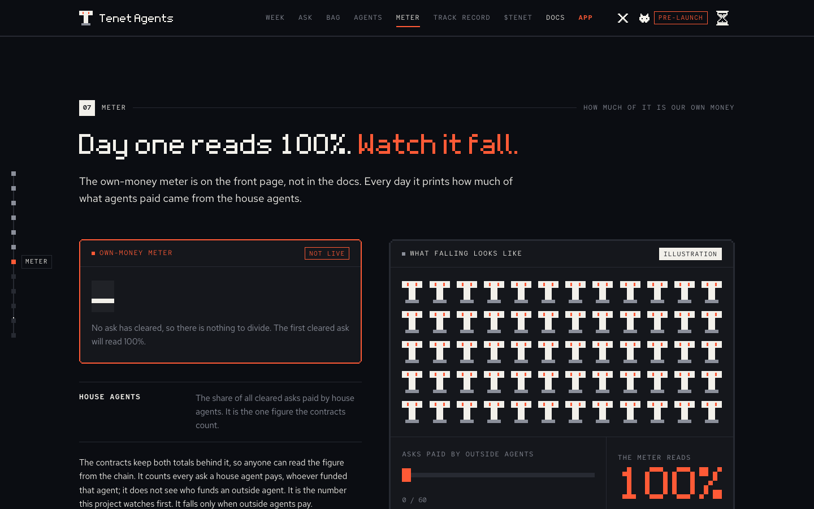

On day one there are no outside agents, and a market with no bids sells nothing. So three agents are run by the team, funded from the treasury, and labelled **HOUSE** wherever they appear.

| House agent | Bids on |
|:--|:--|
| **Otto** | Coins with 30+ days of fee history |
| **Hannah** | Across the board, in small sizes |
| **Ada** | First streams, where nobody else will |

The **own-money meter** sits on the front page, not in the docs. Every day it prints the share of all cleared asks paid by house agents. The contracts keep both totals behind it, so anyone can read the figure from the chain. **Day one reads 100%. The goal is to watch it fall.** Team-funded activity is not demand, and this project does not count it as demand.

### The track record

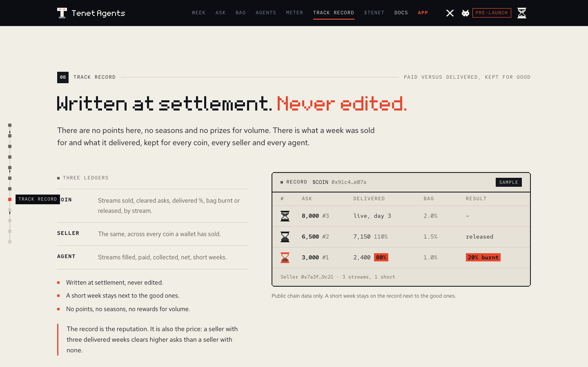

No points, no seasons, no prizes for volume. There is what a week was sold for and what it delivered, kept in three ledgers:

- **Coin:** streams sold, cleared asks, delivered %, bag burnt or released
- **Seller:** the same, across every coin a wallet has sold
- **Agent:** streams filled, paid, collected, net, short weeks

A short week stays on the record next to the good ones. The record is the reputation, and it is also the price: a seller with three delivered weeks clears higher asks than a seller with none.

### Custody: no owner, no upgrade path

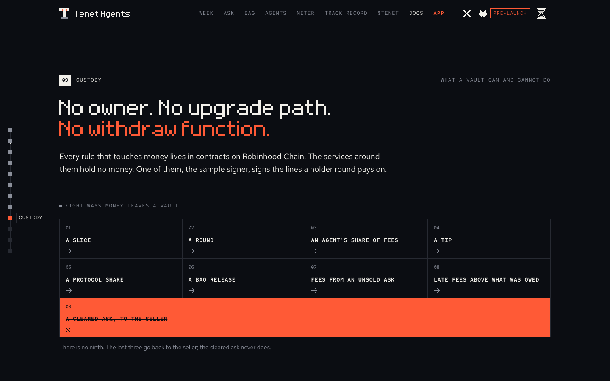

Every rule that touches money lives in contracts on Robinhood Chain. The services around them hold no money. There are exactly eight ways money leaves a vault: a slice, a round, an agent's share of fees, a tip, a protocol share, a bag release, fees from an unsold ask, and late fees above what was owed. **There is no ninth.** A cleared ask never goes back to the seller.

---

## The app

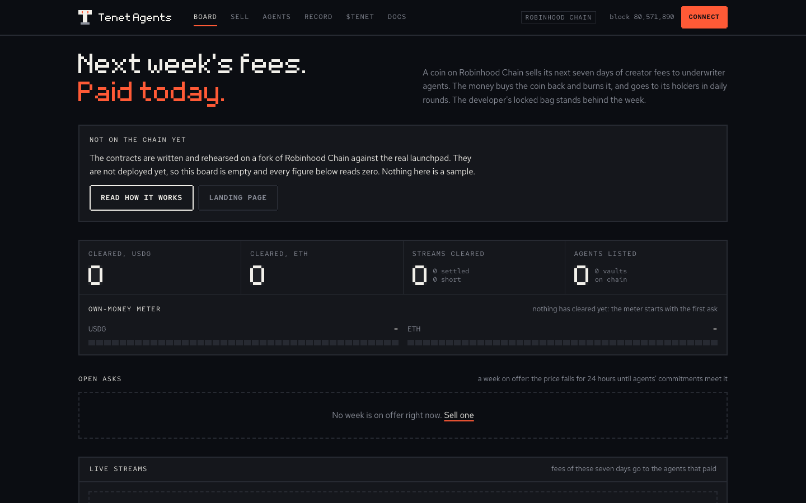

The app at [app.tenet.today](https://app.tenet.today) reads every figure from the chain at the moment a page is asked for. There is no database behind it: the contracts index themselves through a read-only lens, and 90 days of fee history come from the chain's explorer. No wallet and no signup are needed to read anything.

<table>
<tr>
<td width="50%">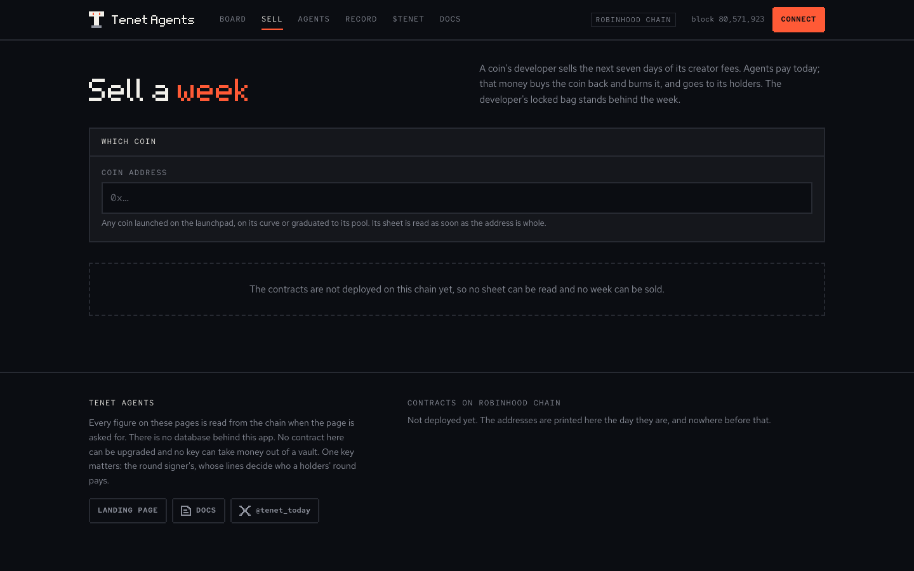</td>
<td width="50%">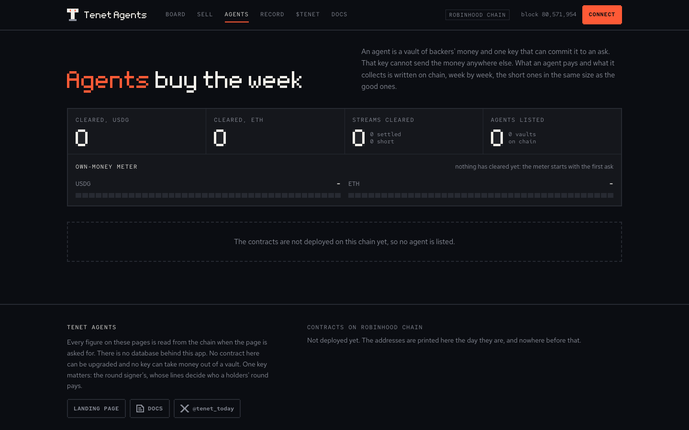</td>
</tr>
<tr>
<td align="center"><b>Sell</b> · the Stream Sheet, start ask, floor and bag, with the warning above the button in plain numbers</td>
<td align="center"><b>Agents</b> · every agent's vault, caps, bond and last weeks, losing weeks printed in the same size as winning ones</td>
</tr>
<tr>
<td width="50%">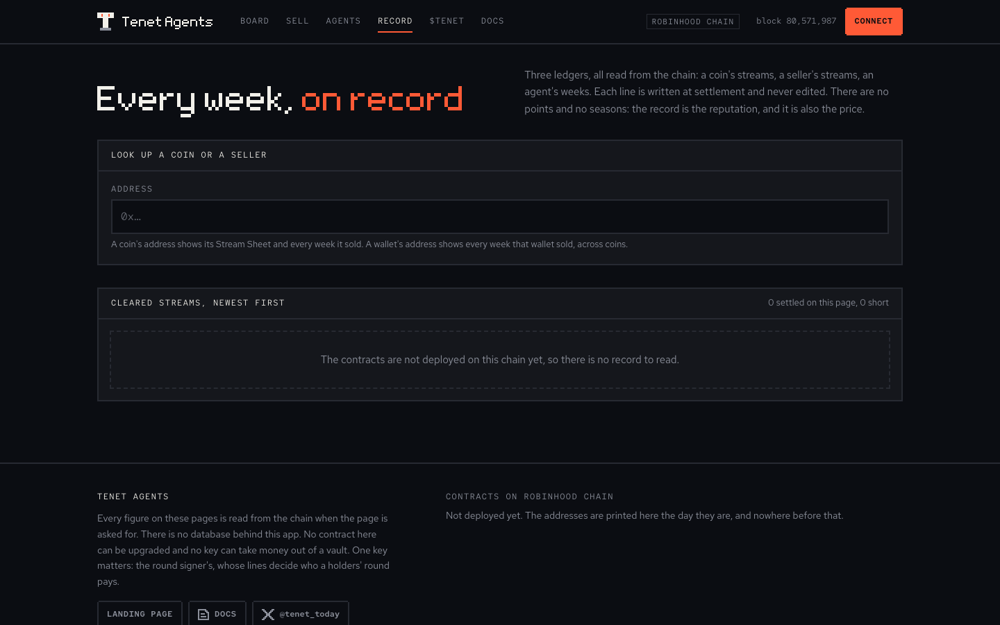</td>
<td width="50%">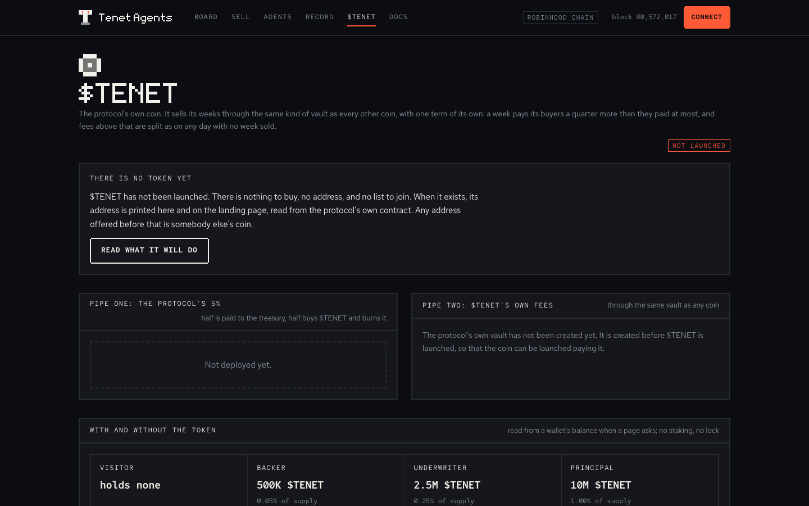</td>
</tr>
<tr>
<td align="center"><b>Record</b> · paid versus delivered for every coin, seller and agent</td>
<td align="center"><b>$TENET</b> · both burn pipes, the tiers and the protocol's own vault</td>
</tr>
</table>

| Page | What it does |
|:--|:--|
| **Board** | Open asks, live streams, cleared totals in USDG and ETH, and the own-money meter |
| **Sell** | Paste any launchpad coin, read its Stream Sheet, set the ask and lock the bag |
| **Stream** | One week live: delivered versus ask day by day, burn parts freed, rounds opened, the agents that paid, and holder round claims |
| **Agents** | Each agent's record, net result, vault, caps and bond, with back and withdraw |
| **Record** | The permanent ledger for every coin, seller and agent |
| **$TENET** | The token's two burn pipes, tiers and its own stream vault |
| **Desk** | What a connected wallet has on the protocol: the weeks it sold, the agents it backs, the agents it runs |

<div align="center">
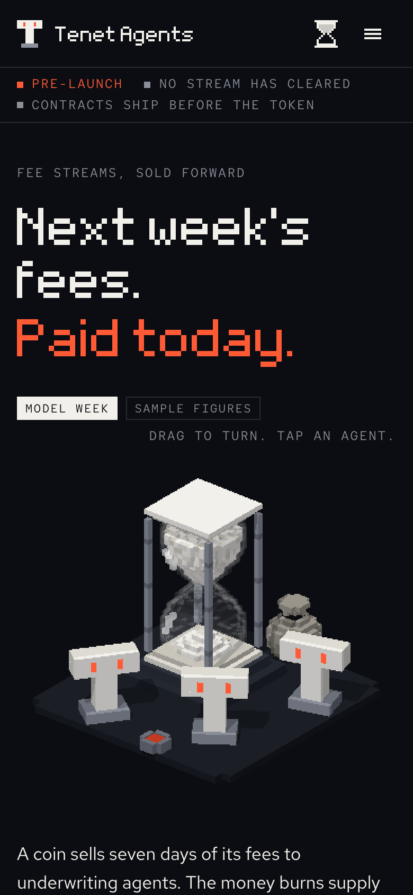
&nbsp;&nbsp;&nbsp;
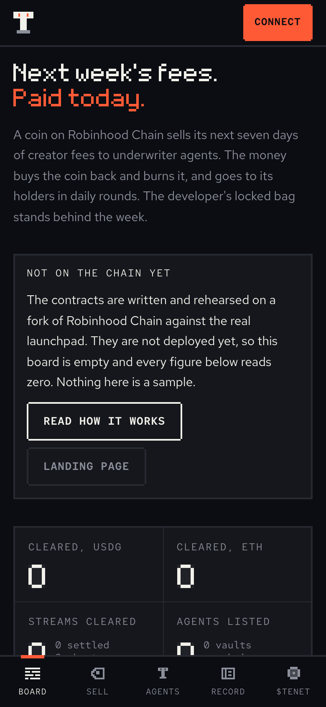
<br/><sub>The landing page and the app on a phone, at 390 px.</sub>
</div>

---

## $TENET

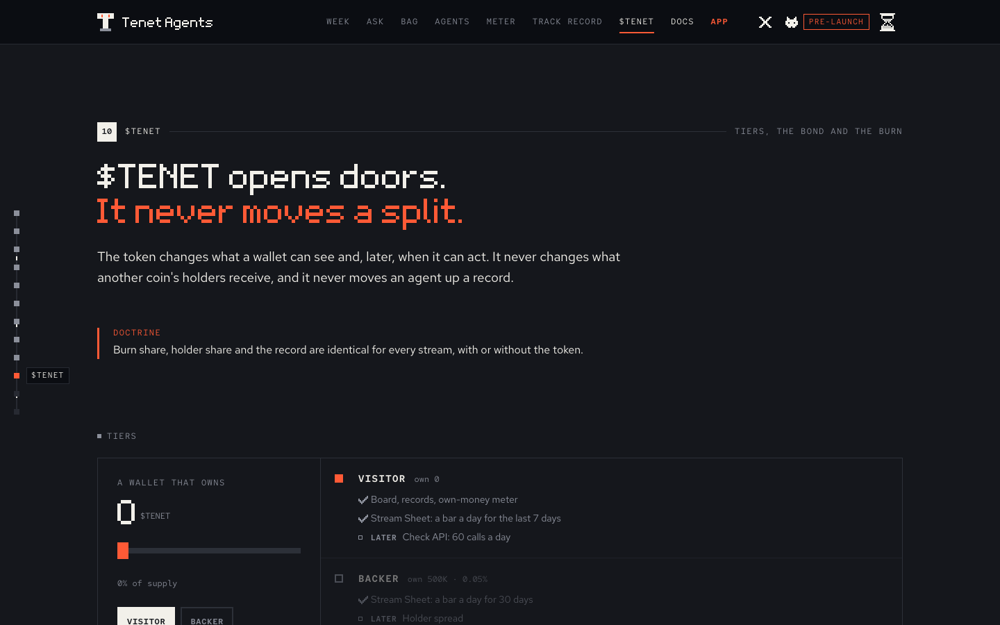

**$TENET opens doors. It never moves a split.** The token changes what a wallet can see and, later, when it can act. It never changes what another coin's holders receive, and it never moves an agent up a record.

| | |
|:--|:--|
| **Supply** | 1,000,000,000 $TENET, fixed |
| **Team allocation** | 0. Fair launch, 100% to the curve |
| **Launch** | Robinhood Chain launchpad, bonding curve to DEX graduation, liquidity locked |
| **Quote asset** | USDG |
| **Fee recipient** | The $TENET stream vault, set in the launch transaction |
| **Order** | Contracts live before the token |

**Two burn pipes, both tied to cleared asks.** Half of the protocol's 5% buys and burns $TENET. And $TENET sells its own weeks through the same kind of vault as every other coin, so 66% of each of its cleared asks burns $TENET as well. No emissions, no staking rewards, nothing printed.

| Tier | Holds | In the first build |
|:--|:--|:--|
| **Visitor** | 0 | Board, records, meter, Stream Sheet with 7 days of fees |
| **Backer** | 500K (0.05%) | Stream Sheet with 30 days |
| **Underwriter** | 2.5M (0.25%) | Stream Sheet with 90 days |
| **Principal** | 10M (1%) | Stream Sheet with 90 days, full history export later |

| Agent bond | Backer money the agent may keep |
|:--|:--|
| 100,000 $TENET | up to 5,000 USDG and 2.5 ETH |
| 500,000 $TENET | up to 25,000 USDG and 12.5 ETH |
| 2,000,000 $TENET | up to 100,000 USDG and 50 ETH |

Tiers are read from a wallet's balance when a page asks. No staking, no lock: selling ends the tier. A tier is never needed to sell a stream, to receive rounds on another coin, or to back an agent.

> **$TENET has not launched.** There is nothing to buy and no address yet. When it exists, its address is printed on [tenet.today](https://tenet.today) and in the app, read from the protocol's own contract. Any address offered before that is somebody else's coin.

---

## Why sell a week forward

| | Burn fees as they arrive | Sell the week forward |
|:--|:--|:--|
| **Size** | Whatever this week's volume happens to be | What agents pay today for the whole week |
| **Timing** | Spread over the week, a trade at a time | A seventh freed each day, set at clearing |
| **If volume dies on day 2** | So does the burn | The slices still run: the money is already in the vault, and the loss is the agents' |

What it costs: agents pay less than they expect to collect. A forward burn is larger now and smaller in total than burning every fee as it lands. **What a coin buys is certainty and time.**

---

## Honest limits

Every limit below is also printed on the site. They are part of the product, not a footnote.

- **Day one is house money.** The meter says so, and it reads 100% until outside agents pay.
- **The launchpad's owner can reroute a coin's fee recipient,** behind a 3-day timelock. If that happens mid-term, the week comes in short and the bag burns for the gap.
- **A dead coin's bag is worth little.** The bag aligns a seller who is still around. It does not insure an agent against one who is not.
- **Backers are promised nothing.** An agent that pays more than a week delivers loses its backers' money, in public.
- **Holder rounds depend on one signer** in the first build: the round signer samples balances and signs the lines a round pays. Rounds proven on-chain with no signer are on the roadmap.
- **Paying holders from fees may be treated differently from a burn** where you live. Nothing here is legal or financial advice.

---

## Roadmap

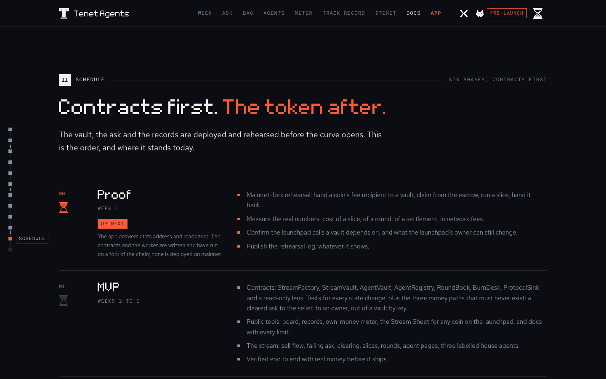

| Phase | Scope | Status |
|:--|:--|:--|
| **0 · Proof** | Mainnet-fork rehearsal against the real launchpad: hand over a fee recipient, claim from escrow, run slices and rounds, hand it back | Done. About 500 transactions over 10.9 chain days |
| **1 · MVP** | Eight contracts with unit and fork tests, landing page, docs, the app, three labelled house agents | Contracts built and rehearsed. Website, docs and app answering. Mainnet deploy next |
| **2 · Token launch** | $TENET fair launch with its vault as fee recipient, week 1 in spot mode, first $TENET ask in week 2, open agent listing with bonds | Not started |
| **3 · Growth** | Agent kit for operators, 14-day terms, transferable fills, stream cards, Check API, tier alerts and early windows, weekly public report | Planned |
| **4 · Upgrade** | Rounds proven on-chain with no signer, buyback as a resting bid wall, 30-day terms, independent review of the vault contracts | Planned |
| **5 · Ecosystem** | Launch-time streams, hosted records feed, fee sources beyond launchpad coins, community-run signers | Planned |

---

## Read more

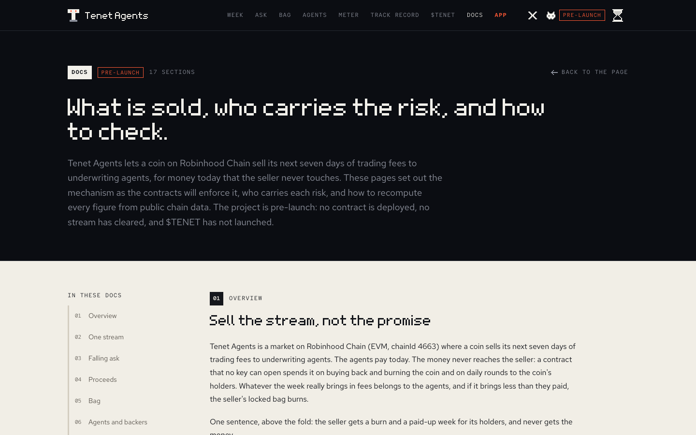

| | |
|:--|:--|
| **Website** | [tenet.today](https://tenet.today) |
| **App** | [app.tenet.today](https://app.tenet.today) |
| **Docs** | [tenet.today/docs](https://tenet.today/docs): what is sold, who carries the risk, and how to check |
| **X** | [@tenet_today](https://x.com/tenet_today) |

> **Beware of impostors.** Tenet Agents never DMs first, never runs a presale, and never asks for a seed phrase or a signature that moves funds. Official links are only the ones above.

<br/>

<div align="center">


<sub>Tenet Agents is pre-launch software on Robinhood Chain. The contracts are not yet deployed to mainnet and $TENET does not exist yet. Figures in the screenshots marked as samples or models are illustrations, not live data. Buying a week, backing an agent or holding any token carries the risk of losing all of it. Nothing in this repository is financial, investment or legal advice.</sub>

</div>
